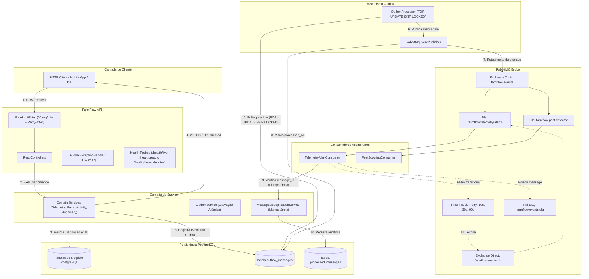

# FarmFlow API

<div align="center">

[](https://openjdk.org/)
[](https://spring.io/projects/spring-boot)
[](https://www.postgresql.org/)
[](https://hibernate.org/)
[](https://www.rabbitmq.com/)
[](https://www.keycloak.org/)
[](https://www.docker.com/)
[](https://opentelemetry.io/)
[](#error-handling)
[](#production-gate)

**Enterprise Agro-Industrial Management & Telemetry Backend Engine**  
*A distributed, event-driven agro-industrial REST API built for transactional consistency, resilience, and asynchronous processing.*

</div>

---

## Resumo Executivo de Engenharia

| Área | Implementação no FarmFlow |
|---|---|
| **Arquitetura** | Layered Architecture + Domain Events com fronteiras transacionais limpas |
| **Runtime & Framework** | Java 21 (LTS) / Spring Boot 4.1.1 |
| **Persistência de Dados** | PostgreSQL 17/18 (PostgreSQL Alpine no Docker) |
| **Mapeamento Objeto-Relacional** | Spring Data JPA + Hibernate 7 + Flyway Migrations |
| **Mensageria Assíncrona** | RabbitMQ 3.x com Spring AMQP nativo |
| **Confiabilidade de Eventos** | **Transactional Outbox Pattern** atômico à transação de persistência relacional |
| **Concorrência no Outbox** | **`FOR UPDATE SKIP LOCKED`** (Workers paralelos selecionam lotes sem contenção de lock) |
| **Topologia de Resiliência** | Topic Exchange (`farmflow.events`), DLX Direct, Filas TTL de Retry (10s, 30s, 90s) e DLQ |
| **Idempotência de Consumo** | Desduplicação atômica via `message_id` auditado (`processed_messages` PK) |
| **Autenticação & OIDC** | Suporte a OIDC Resource Server via Keycloak 26.1 (RS256) e RBAC (`Admin`, `FarmManager`, `Agronomist`, `Operator`) |
| **Rastreamento Distribuído** | W3C `traceparent` contínuo HTTP &rarr; Outbox &rarr; RabbitMQ &rarr; Consumidor &rarr; Jaeger |
| **Tratamento de Falhas** | **RFC 9457 `ProblemDetails`** sanitizado com mascaramento total de credenciais e SQL |
| **Proteção de Runtime** | Rate Limiting em memória por instância (Fixed Window: 60 req/min) com RFC 9457 e `Retry-After: 60` |
| **Métricas Operacionais** | Micrometer (`farmflow.outbox.*`, `farmflow.consumer.*`) com estrita disciplina de cardinalidade |
| **Sondas de Saúde (Probes)** | Liveness (`/health/live`), Readiness (`/health/ready`), Dependências (`/health/dependencies` com estado `DEGRADED`) |
| **Governança de Engenharia** | **16 Architecture Decision Records (ADRs)** + 4 Cadernos Operacionais de Remediação (SRE) |
| **Busca Semântica Local** | 100% offline em Python (LanceDB + SentenceTransformers `all-MiniLM-L6-v2`) para código Java e ADRs |
| **Testes de Carga & Automação** | k6 em JavaScript (`auth-helper.js`, benchmarks de saúde e telemetria) + runner PowerShell |

---

## Arquitetura do Sistema

A arquitetura do FarmFlow garante que a mutação de estado de negócio e a produção de eventos ocorram sob a mesma transação ACID do PostgreSQL. O RabbitMQ opera como downstream assíncrono desacoplado, **sem jamais participar da transação original**.



---

## Transactional Outbox e Concorrência com `SKIP LOCKED`

O padrão Transactional Outbox resolve o problema clássico de *dual-write hazard* em sistemas distribuídos:

```
❌ DUAL-WRITE HAZARD:
1. Salva no Banco  ──> Commit relacional
2. Publica RabbitMQ ──> Queda de rede ou crash da JVM!
Resultado: Dados gravados no banco, mas evento perdido para sempre.
```

```
✅ TRANSAÇÃO ATÔMICA COM OUTBOX:
1. Serviço de domínio processa comando.
2. Grava mutação de negócio E evento na tabela 'outbox_messages' sob a MESMA transação ACID.
3. Se o banco falhar, ambas as gravações sofrem rollback.
4. O OutboxProcessor em segundo plano seleciona mensagens e despacha para o broker.
```

### Polling Multi-Instância sem Contenção:
```sql
SELECT * FROM outbox_messages
WHERE processed_on IS NULL AND attempts < :maxAttempts
ORDER BY occurred_on
LIMIT :batchSize
FOR UPDATE SKIP LOCKED;
```
Quando múltiplos pods ou instâncias da API executam o polling concorrentemente, o PostgreSQL ignora imediatamente linhas bloqueadas por outros workers sem tempo de espera (`lock_wait = 0ms`), garantindo processamento disjunto e escalabilidade horizontal sem duplicações.

---

## Topologia de Mensageria Resiliente (RabbitMQ)

- **Exchange Principal:** `farmflow.events` (Tipo `Topic`, durável).
- **Filas de Negócio:**
  - `farmflow.telemetry.alerts`: Roteamento `telemetry.alert.#` (com DLX).
  - `farmflow.pest.detected`: Roteamento `pest.detected.#` (com DLX).
  - `farmflow.machinery.maintenance`: Roteamento `machinery.maintenance.#` (com DLX).
- **Dead-Letter Exchange (DLX):** `farmflow.events.dlx` (Tipo `Direct`, durável).
- **Filas TTL de Reprocessamento Escalonado:**
  - `farmflow.events.retry.10s` (TTL: 10.000 ms &rarr; DLX)
  - `farmflow.events.retry.30s` (TTL: 30.000 ms &rarr; DLX)
  - `farmflow.events.retry.90s` (TTL: 90.000 ms &rarr; DLX)
- **Dead-Letter Queue (DLQ):** `farmflow.events.dlq` (durável, retém poison messages com `x-dlq-reason`).

---

## Sondas de Saúde e Degradação Graciosa

A API provê probes compatíveis com orquestradores (Kubernetes / ECS / Docker Compose):

| Sonda | Rota | Comportamento e Semântica | Sucesso |
|---|---|---|:---:|
| **Liveness** | `GET /health/live` | Avaliação em memória sem I/O externo. Confirma que a JVM está respondendo. | `200 OK` |
| **Readiness** | `GET /health/ready` | Validação de conectividade ativa com o PostgreSQL via pool de conexões. | `200 OK` / `503` |
| **Dependências** | `GET /health/dependencies` | Inspeção diagnóstica de PostgreSQL e RabbitMQ. Reporta `HEALTHY` quando ambos respondem, `DEGRADED` (HTTP 200) se o RabbitMQ estiver offline (demonstrando que comandos de escrita continuam comitando normalmente via Outbox), e `UNHEALTHY` (HTTP 503) se o banco de dados estiver offline. | `200 OK` / `503` |

---

## Tratamento de Erros e ProblemDetails (RFC 9457)

Todos os erros retornados pela API aderem ao padrão IETF RFC 9457:

```json
{
  "type": "https://tools.ietf.org/html/rfc9457",
  "title": "Not Found",
  "status": 404,
  "detail": "Farm with ID farm-123 not found",
  "instance": "/v1/farms/farm-123",
  "traceId": "c8a412c9-66bf-498c-982c-473d09a473d0",
  "timestamp": "2026-10-20T00:15:00Z"
}
```

- **Sanitização Estrita:** Respostas de erro 500 ou 409 jamais vazam nomes de tabelas, consultas SQL, versões de drivers ou credenciais de banco. O erro é rastreado nos logs internos através do identificador `traceId`.

---

## Decisões Arquiteturais (16 ADRs)

| ADR | Título | Foco Arquitetural |
|---|---|---|
| [ADR-001](docs/adr/ADR-001-transactional-outbox.md) | Transactional Outbox Pattern for Reliable Event Publishing | Eliminação de dual-write hazard com persistência atômica no PostgreSQL |
| [ADR-002](docs/adr/ADR-002-postgresql-concurrency-control.md) | PostgreSQL Concurrency Control via SKIP LOCKED and Optimistic Locking | Particionamento de workers sem lock contention e versionamento JPA |
| [ADR-003](docs/adr/ADR-003-rabbitmq-messaging-topology.md) | RabbitMQ Messaging Topology with Staged TTL Retries and DLQ | Topologia durável com backoff escalonado por TTL e DLQ |
| [ADR-004](docs/adr/ADR-004-postgresql-as-primary-coordination-engine.md) | PostgreSQL as Sole Primary Coordination Engine | Prevenção de complexidade acoplada a Redis e garantias ACID nativas |
| [ADR-005](docs/adr/ADR-005-w3c-trace-context.md) | W3C Trace Context Propagation Across Async Boundaries | Rastreabilidade distribuída contínua HTTP &rarr; Outbox &rarr; AMQP &rarr; Consumidor |
| [ADR-006](docs/adr/ADR-006-bounded-at-least-once-delivery.md) | Bounded At-Least-Once Delivery and Consumer Idempotency | Desduplicação por constraint de PK na tabela `processed_messages` |
| [ADR-007](docs/adr/ADR-007-rfc-9457-problem-details.md) | RFC 9457 ProblemDetails and Exception Sanitization | Padronização IETF com mascaramento total de infraestrutura |
| [ADR-008](docs/adr/ADR-008-in-process-rate-limiting.md) | In-Process Rate Limiting with Retry-After Header | Proteção de nós contra sobrecarga com HTTP 429 e `Retry-After: 60` |
| [ADR-009](docs/adr/ADR-009-health-check-probing-semantics.md) | Decoupled Health Probing and Graceful Degradation Semantics | Sondas de saúde desacopladas e relatório com estado `DEGRADED` |
| [ADR-010](docs/adr/ADR-010-sli-slo-error-budget.md) | Service Level Objectives (SLOs) and Error Budget Framework | Framework de metas quantitativas de latência e disponibilidade |
| [ADR-011](docs/adr/ADR-011-operational-metrics-and-cardinality.md) | Operational Metrics and Telemetry Cardinality Discipline | Métricas com Micrometer e cardinalidade delimitada para Outbox e Consumer |
| [ADR-012](docs/adr/ADR-012-empirical-performance-baseline-k6.md) | Empirical Performance Baseline via k6 | Baseline reproduzível com k6 em perfis de carga nominal, sustentada e spike |
| [ADR-013](docs/adr/ADR-013-capacity-engineering-and-domain-workloads.md) | Capacity Engineering and Domain Workload Boundaries | Delimitação estrita entre vazão in-memory e capacidade relacional de domínio |
| [ADR-014](docs/adr/ADR-014-multi-tenant-isolation-security.md) | Multi-Tenant Isolation and Farm Security Boundaries | Avaliação declarativa de acesso multi-inquilino via Spring Method Security |
| [ADR-015](docs/adr/ADR-015-zero-comment-code-discipline.md) | Zero-Comment Code Discipline and Clean Code Policy | Política estrita de zero comentários em arquivos de código Java |
| [ADR-016](docs/adr/ADR-016-openid-connect-keycloak.md) | OpenID Connect Resource Server with Keycloak and RS256 | Federação com Keycloak OIDC, validação assimétrica RS256 e RBAC |

---

## Cadernos Operacionais de Remediação (SRE Runbooks)

| Runbook | Gatilho Primário | Ação de Mitigação |
|---|---|---|
| [PostgreSQL Unavailable](docs/runbooks/postgresql-unavailable.md) | Banco offline ou pool Hikari esgotado | Verificar status do serviço, investigar locks, reiniciar instância |
| [RabbitMQ Unavailable](docs/runbooks/rabbitmq-unavailable.md) | Broker offline ou socket recusado | O sistema preserva escritas via Outbox; reiniciar broker; drenagem automática |
| [Outbox Backlog Accumulation](docs/runbooks/outbox-backlog.md) | Mensagens pendentes > 500 no banco | Inspecionar rede, redefinir tentativas de mensagens com erro ou escalar workers |
| [Consumer DLQ Triage](docs/runbooks/consumer-dlq.md) | Mensagens acumulando na DLQ | Inspecionar payload corrompido, corrigir schema downstream, reprocessar ou purgar |

---

## Busca Semântica Local no Código (Python & LanceDB)

A ferramenta em Python permite pesquisar semanticamente em classes Java, métodos e ADRs 100% offline:
```bash
# Instalar dependências da ferramenta vetorial
pip install -r tools/vector-search/requirements.txt

# Indexar o repositório em banco vetorial local (.vector-db/)
python -m tools.vector_search.index

# Realizar busca semântica por similaridade de cosseno
python -m tools.vector_search.search "outbox skip locked"
```

---

## Como Executar

### 1. Stack Containerizada Completa (API + PostgreSQL + RabbitMQ + Keycloak + Jaeger)
```bash
docker compose up --build
```
- API REST: `http://localhost:8080/v1`
- Swagger UI: `http://localhost:8080/v1/swagger-ui.html`
- Keycloak IdP: `http://localhost:8081` (Realm: `farmflow`, Admin: `admin` / `admin`)
- RabbitMQ Management: `http://localhost:15672` (Usuário: `guest`, Senha: `guest`)
- Jaeger UI: `http://localhost:16686`

### 2. Execução dos Testes Automatizados
```bash
# Executar todos os testes de unidade e resiliência
.\mvnw.cmd test

# Executar suíte de testes de carga k6
.\load-tests\run-benchmarks.ps1 -Suite Health
.\load-tests\run-benchmarks.ps1 -Suite Telemetry
```

---

## Autor

**Autor:** Yuri Vieira  
**GitHub:** [https://github.com/DevYuriVieira](https://github.com/DevYuriVieira)